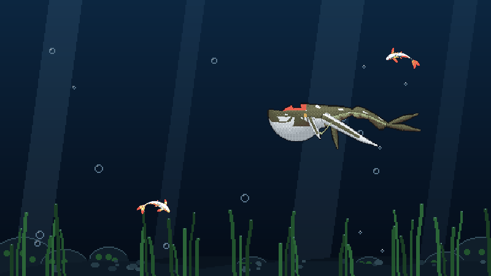

  

  
  

## 🌊 The ocean

  

My Tulkun grows with my contributions — a baby calf every January 1st, an adult bull by the end of the year. It holds its place while the koi swim past, redrawn every night from yesterday's activity.

  <picture>
    <source media="(prefers-color-scheme: dark)" srcset="https://raw.githubusercontent.com/GeltraxGT/GeltraxGT/snake/dist/github-contribution-grid-snake-dark.svg" />
    <source media="(prefers-color-scheme: light)" srcset="https://raw.githubusercontent.com/GeltraxGT/GeltraxGT/snake/dist/github-contribution-grid-snake.svg" />
    
  </picture>

## 📊 Stats

  
  

  

  

## 🛠️ Tech stack

**languages**
 

**frontend**
 

**mobile**
 

**backend & data**
 

**AI & agents**
 

## 🚀 What I'm building

| | |
|---|---|
| **[ScoreCast](https://github.com/Geltrax69/SCORDBOARD_DISPLAY)** — live sepak takraw scoreboard, TV display + scorer phone | **[Campfire Cooking](https://github.com/Geltrax69/Campfire_Cooking)** — a living-world game, 875 simulation tests green |
| **[Shadows of the Broken Dynasty](https://github.com/Geltrax69/fast-pace)** — third-person wuxia combat game | **[Sepaktraw / UPSTA](https://github.com/Geltrax69/Sepaktraw_2)** — association site + live scores |
| **[3jsFun2](https://github.com/GeltraxGT/3jsFun2)** — 3D arena shooter in the browser | **[MacCleaner](https://github.com/Geltrax69/mac_TaskManager)** — native macOS task manager in Swift |
| **[Papier](https://github.com/Geltrax69/Crazy_Wallpaper)** — editorial wallpaper store | **[Simpedu](https://github.com/Geltrax69/new_Company)** — school platform, less manual work |

## ⚡ How I work

- Build fast, ship same day, verify with real builds and tests.
- Building in public — a LinkedIn post every day at noon.
- Pattern-first learning: name the pattern, build it, break it, reuse it.
- Agents do the heavy lifting; I make the calls.

---

> Build. Ship. Repeat.
